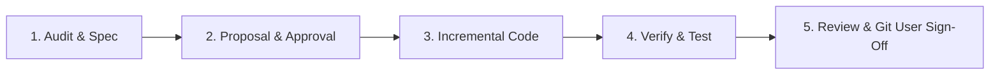

# AiNARA Mobile Development Guidelines & AI Agent Rules

Dokumen ini adalah panduan baku dan *ground truth rules* bagi AI Agent dan Developer saat bekerja di repositori **AiNARA Mobile** (`ainara_mobile` / Flutter cross-platform client). Semua instruksi di bawah ini bersifat **MANDATORI**.

---

## 1. Core Principles & Guardrails

### 🛡️ Rule 1: Zero Working-Line Removal (Non-Destructive Edits)
- **JANGAN PERNAH** menghapus, menimpa (*overwrite*), atau me-refactor kode, widget, service, model, maupun route yang sudah berfungsi dan lolos test, kecuali diminta secara eksplisit oleh USER.
- Terapkan prinsip **additive & incremental development**: buat widget baru, helper baru, method baru, atau tambahkan parameter opsional dengan default value.
- Pastikan *backward compatibility* tetap terjaga pada seluruh interaksi API backend Laravel (`AiraMod`).

### 🛑 Rule 2: Strict Git Guardrail (No Unapproved Commit or Push) — WAJIB!
- **DILARANG KERAS** menjalankan `git push` atau `git commit` secara otomatis ke repositori tanpa persetujuan eksplisit dari USER.
- Setiap kali pekerjaan selesai:
  1. Tampilkan ringkasan file yang disentuh (`git status -s` / `git diff`).
  2. Laporkan hasil verifikasi pengujian (`flutter test` dan `flutter analyze`).
  3. **TUNGGU instruksi dan persetujuan eksplisit dari USER** sebelum menjalankan commit atau push ke remote repo.

### 🔍 Rule 3: Context-First Audit (Read Before Write)
- **Sebelum menulis kode apapun**, lakukan audit terlebih dahulu:
  1. Periksa model (`lib/models/`), service API (`lib/services/`), dan storage (`lib/core/storage/`).
  2. Periksa apakah sudah ada komponen UI/widget yang reusable di `lib/widgets/` agar tidak terjadi duplikasi.
  3. Cek endpoint API backend di `lib/core/api/api_endpoints.dart` dan pastikan sinkron dengan kontrak API backend di `AiraMod` (`routes/api.php`).

### ✋ Rule 4: Approval Before Execution
- **JANGAN LANGSUNG** memodifikasi kode atau menambahkan dependency/plugin (`pubspec.yaml`) saat menerima instruksi tugas baru.
- Selalu paparkan proposal rencana langkah kerja (arsitektur, rincian file yang akan dibuat/diubah, dan alur integrasi UI) terlebih dahulu.
- Tunggu konfirmasi dan persetujuan dari USER sebelum mengeksekusi perubahan.

### 🧪 Rule 5: Mandatory Quality & Test Verification (Green Suite)
- Setiap penambahan fitur atau modifikasi logic:
  - Jalankan analisa statis: `flutter analyze` (Wajib **0 issues / 0 warnings**).
  - Jalankan test suite: `flutter test` (Wajib seluruh unit test & widget test **PASSING**).
  - Tambahkan unit/widget test baru untuk fitur penting di folder `test/`.

### 🔐 Rule 6: Zero Hardcoded Secrets & Dynamic Networking
- Kredensial sensitif, token otentikasi, dan sesi pengguna **WAJIB** disimpan menggunakan hardware-backed storage (`FlutterSecureStorage`).
- URL dasar API (`API_BASE_URL`) harus tetap dinamis dan mendukung pengaturan konfigurasi server via modal/UI agar fleksibel saat berpindah antara lingkungan lokal, staging, dan VPS live (`https://ainara.dstr.biz.id/api/v1`).

---

## 2. Standard Development Flow (SOP)

Setiap siklus pengerjaan tugas harus mengikuti 5 fase:



1. **Fase 1: Audit & Spec**
   - Periksa UI requirements, state management, dan endpoint API yang dibutuhkan.
   - Cek struktur file eksisting di `lib/` dan dependency di `pubspec.yaml`.
2. **Fase 2: Proposal & Approval (Wajib)**
   - Paparkan rencana perubahan, daftar file yang akan disentuh, dan alur UX kepada USER.
   - **Tunggu persetujuan USER sebelum memulai coding.**
3. **Fase 3: Incremental Code**
   - Terapkan perubahan dengan lingkup minimal, bersih, dan modular.
   - Ikuti konvensi Dart/Flutter (Effective Dart, widget tree separation, const constructors).
4. **Fase 4: Verify & Test**
   - Jalankan verifikasi kualitas:
     ```bash
     flutter analyze
     flutter test
     ```
   - Pastikan tidak ada compile error atau regression.
5. **Fase 5: Review & Git User Sign-Off (Tidak Push Otomatis)**
   - Paparkan status perubahan kepada USER.
   - Mintakan konfirmasi apakah perubahan ingin di-commit dan di-push ke GitHub.

---

## 3. Repositori & Tech Stack Guidelines

### A. Core Framework & Runtime
- **Framework:** Flutter 3.22.3 (Channel stable) + Dart 3.4.4
- **Mobile Platform:** Android (primary, SDK 34-36) & iOS (ready)
- **Tooling:** Android Studio 2024.2 (Ladybug) + Java 21 JBR + OpenJDK 17 target

### B. Android Native Configuration
- **Gradle:** Version 8.5 (`gradle-8.5-all.zip`)
- **Android Gradle Plugin (AGP):** Version 8.3.2
- **Kotlin:** Version 1.9.22
- **SDK Constraints:** `compileSdk = 36`, `targetSdk = 34`, `minSdk = 23`
- **Java Compatibility:** `JavaVersion.VERSION_17` & `kotlinOptions { jvmTarget = '17' }`
- **Application Label:** `AiNARA` (dikonfigurasi di `AndroidManifest.xml`)

### C. Architecture & Directory Structure
```text
ainara_mobile/
├── android/                  # Android native project & Gradle wrapper
├── ios/                      # iOS native project
├── lib/
│   ├── core/                 # Core configs, constants, API endpoints, themes, secure storage
│   ├── models/               # Data models & serialization (JSON to Dart)
│   ├── screens/              # UI Screens (Auth, Student, Parent, Safeguarding/LANTANG)
│   ├── services/             # API HTTP services & business logic calls
│   ├── widgets/              # Reusable UI components & custom dialogs
│   └── main.dart             # Application root entry point
├── test/                     # Unit, widget, and integration tests
└── pubspec.yaml              # Flutter dependencies and assets
```

### D. Integration with AiNARA Backend (`AiraMod`)
- **Base API URL:** `https://ainara.dstr.biz.id/api/v1`
- **Authentication:** Bearer token via Laravel Sanctum (`Authorization: Bearer <token>`).
- **Response Format:** Standard JSON response `{ success: bool, message: string, data: ... }`.
- **Photo Evidence:** Multi-part file upload (`MultipartFile`) untuk dokumentasi belajar & laporan perlindungan anak (LANTANG).
